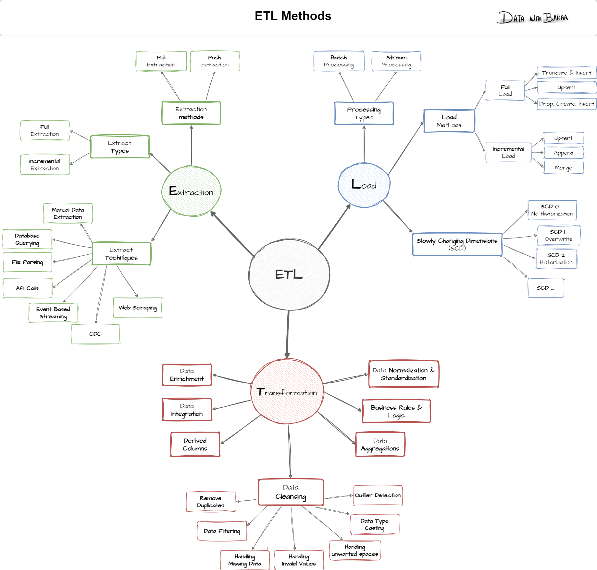

# SQL Data Warehouse Project

[](#technologies-used)
[](#etl-pipeline)
[](#getting-started-macos)
[](#technologies-used)
[](https://github.com/DE-Adham-Amin/SQL_Data_Warehouse_Project)
[](LICENSE)

An end-to-end **Microsoft SQL Server** data warehouse that integrates data from **CRM** and **ERP** systems through SQL-based **ETL pipelines**, transforming raw CSV files into clean, structured, analytics-ready datasets.

The project follows **Medallion Architecture**: data moves through **Bronze**, **Silver**, and **Gold** layers, where it is progressively ingested, cleaned, standardized, and modeled into a **Star Schema** for analytical workloads.

Developed on **macOS** using **Docker** and **Visual Studio Code**, this repository demonstrates the core data engineering workflow from source ingestion to business-ready dimensional views.

**Author:** [Adham Amin Hassan](https://github.com/DE-Adham-Amin) | **Role:** Aspiring Data Engineer

> **New to the project?** Start with [Getting Started (macOS)](#getting-started-macos) for the Docker setup, SQL Server connection settings, and script execution sequence.

---

## 📑 Table of Contents

1. [Introduction](#sql-data-warehouse-project)
2. [Repository Structure](#repository-structure)
3. [Data Architecture](#data-architecture)
4. [Project Overview](#project-overview)
5. [Project Requirements](#project-requirements)
6. [Data Sources](#data-sources)
7. [ETL Pipeline](#etl-pipeline)
8. [Data Modeling: Star Schema](#data-modeling-star-schema)
9. [Data Quality Checks](#data-quality-checks)
10. [Project Documentation](#project-documentation)
11. [Technologies Used](#technologies-used)
12. [Getting Started (macOS)](#getting-started-macos)
13. [Project Scope & Future Improvements](#project-scope-future-improvements)
14. [Connect](#connect)
15. [License](#license)
16. [About Me](#about-me)

---

<a name="repository-structure"></a>

## 🗂️ Repository Structure

The repository separates source datasets, architecture documentation, layer-specific SQL scripts, and data quality checks.

```text
SQL_Data_Warehouse_Project/
│
├── datasets/
│   ├── source_crm/
│   │   ├── cust_info.csv
│   │   ├── prd_info.csv
│   │   └── sales_details.csv
│   │
│   └── source_erp/
│       ├── CUST_AZ12.csv
│       ├── LOC_A101.csv
│       └── PX_CAT_G1V2.csv
│
├── docs/
│   ├── Data Architectures.png
│   ├── Data Flow.png
│   ├── Data Integration.png
│   ├── ETL.png
│   ├── High Level Architecture.png
│   ├── Star Scheme.png
│   ├── data_catalog.md
│   ├── data_layers.pdf
│   └── naming_conventions.md
│
├── scripts/
│   ├── init_database.sql
│   │
│   ├── bronze/
│   │   ├── ddl_bronze.sql
│   │   └── load_bronze.sql
│   │
│   ├── Silver/
│   │   ├── ddl_silver.sql
│   │   ├── silver.crm_cust_info.sql
│   │   ├── silver.crm_prd_info.sql
│   │   ├── silver.crm_sales_details.sql
│   │   ├── silver_erp_cust_az12.sql
│   │   ├── silver_erp_loc_a101.sql
│   │   ├── silver_erp_px_cat_g1v2.sql
│   │   └── silver_load.sql
│   │
│   └── gold/
│       └── ddl_gold.sql
│
├── tests/
│   └── quality_checks_gold.sql
│
├── LICENSE
└── README.md
```

> **Path conventions:** The `scripts/Silver/` directory uses a capital `S`. Preserve the supplied capitalization and filenames when opening scripts or creating links.

---

<a name="data-architecture"></a>

## 🏗️ Data Architecture

The warehouse follows **Medallion Architecture**, separating raw ingestion, data preparation, and analytical modeling into three clearly defined layers.


| Layer | Data State | Responsibilities | Output |
|:--|:--|:--|:--|
| **Bronze** | Raw | Ingest CRM and ERP CSV files into SQL Server without applying business transformations. Preserve the source data as received. | Raw source tables |
| **Silver** | Cleaned and standardized | Remove duplicates, handle missing and invalid values, standardize data, validate fields, and prepare consistent CRM and ERP datasets. | Reliable, transformed tables |
| **Gold** | Business-ready | Organize customer, product, and sales data into a Star Schema for analytical workloads. | Two dimension views and one fact view |

1. **Bronze Layer:** Establishes the raw ingestion boundary. A stored procedure manages the loading process using a **Full Load** strategy.
2. **Silver Layer:** Applies cleaning, standardization, integration, and business transformation rules to improve consistency and reliability.
3. **Gold Layer:** Exposes analytics-ready data through `gold.dim_customers`, `gold.dim_products`, and `gold.fact_sales`.

---

<a name="project-overview"></a>

## 📖 Project Overview

This project demonstrates how data from separate business systems can be consolidated into a centralized SQL Server data warehouse.

1. **Design the architecture:** Structure the warehouse into Bronze, Silver, and Gold layers with clearly defined responsibilities.
2. **Build the ETL pipelines:** Ingest six source files, clean and transform their contents, and prepare integrated datasets.
3. **Model the data:** Create customer and product dimensions alongside a sales fact view using a Star Schema.
4. **Validate the Gold Layer:** Check business-ready data and dimensional relationships with a dedicated SQL quality-check script.
5. **Document the solution:** Maintain architecture diagrams, a data catalog, layer documentation, and naming conventions.

### High-Level Architecture

The following diagram provides a high-level view of the warehouse solution.


> **Current delivery:** Data warehouse construction, ETL, dimensional modeling, documentation, and Gold Layer quality checks. SQL-based analytics and BI dashboards are planned enhancements, not implemented deliverables.

---

<a name="project-requirements"></a>

## 🚀 Project Requirements

### Building the Data Warehouse (Data Engineering)

**Objective:** Build a SQL Server data warehouse that consolidates CRM and ERP data into clean, structured datasets suitable for analytical reporting.

| Requirement | Project Specification |
|:--|:--|
| **Data sources** | Import six CSV files from CRM and ERP systems. |
| **Architecture** | Separate processing into Bronze, Silver, and Gold layers. |
| **Raw ingestion** | Use a stored procedure and a Full Load strategy for the Bronze Layer. |
| **Data preparation** | Resolve duplicates, missing values, invalid fields, and inconsistent formats through Silver transformations. |
| **Integration** | Bring customer, product, and sales information from both systems into a unified analytical model. |
| **Data modeling** | Expose two dimension views and one fact view in the Gold Layer, connected through surrogate keys. |
| **Quality assurance** | Validate Gold Layer data and dimensional relationships; dedicated Silver checks remain planned. |
| **Documentation** | Provide architecture, ETL, data flow, integration, Star Schema, data catalog, layer, and naming documentation. |
| **Development environment** | Run SQL Server in Docker on macOS and develop SQL scripts in Visual Studio Code. |

---

<a name="data-sources"></a>

## 🗃️ Data Sources

The project uses **six CSV files** from **two source systems**. CRM supplies customer, product, and sales data; ERP provides additional customer, location, and product classification information.

### CRM System

| File | Description |
|:--|:--|
| [`cust_info.csv`](datasets/source_crm/cust_info.csv) | Customer information |
| [`prd_info.csv`](datasets/source_crm/prd_info.csv) | Product information |
| [`sales_details.csv`](datasets/source_crm/sales_details.csv) | Sales transactions |

### ERP System

| File | Description |
|:--|:--|
| [`CUST_AZ12.csv`](datasets/source_erp/CUST_AZ12.csv) | Additional customer information |
| [`LOC_A101.csv`](datasets/source_erp/LOC_A101.csv) | Customer location information |
| [`PX_CAT_G1V2.csv`](datasets/source_erp/PX_CAT_G1V2.csv) | Product categories and subcategories |

### Data Integration

The integration documentation shows how the CRM and ERP datasets contribute to the warehouse's customer, product, and sales information.


---

<a name="etl-pipeline"></a>

## ⚙️ ETL Pipeline

The ETL workflow separates source ingestion from cleaning and analytical modeling. Each layer builds on the output of the previous layer.



<a name="bronze-layer"></a>

### Bronze Layer: Raw Data Ingestion

- Create Bronze tables for the CRM and ERP source datasets.
- Load the six CSV files into SQL Server.
- Preserve source data without business transformations.
- Use a **stored procedure** to manage the loading process.
- Apply a **Full Load** strategy to ingest the complete source datasets.

| Script | Purpose |
|:--|:--|
| [`scripts/bronze/ddl_bronze.sql`](scripts/bronze/ddl_bronze.sql) | Define the Bronze source tables. |
| [`scripts/bronze/load_bronze.sql`](scripts/bronze/load_bronze.sql) | Define the stored procedure that manages raw CSV ingestion. |

<a name="silver-layer"></a>

### Silver Layer: Data Cleaning & Transformation

- Remove duplicate records.
- Handle missing and invalid values.
- Standardize text and categorical values.
- Validate date and numeric fields.
- Integrate CRM and ERP datasets.
- Apply business transformation rules.

| Script | Purpose |
|:--|:--|
| [`scripts/Silver/ddl_silver.sql`](scripts/Silver/ddl_silver.sql) | Define the Silver tables. |
| [`scripts/Silver/silver.crm_cust_info.sql`](scripts/Silver/silver.crm_cust_info.sql) | Clean and transform CRM customer information. |
| [`scripts/Silver/silver.crm_prd_info.sql`](scripts/Silver/silver.crm_prd_info.sql) | Clean and transform CRM product information. |
| [`scripts/Silver/silver.crm_sales_details.sql`](scripts/Silver/silver.crm_sales_details.sql) | Clean and transform CRM sales transactions. |
| [`scripts/Silver/silver_erp_cust_az12.sql`](scripts/Silver/silver_erp_cust_az12.sql) | Clean and transform ERP customer information. |
| [`scripts/Silver/silver_erp_loc_a101.sql`](scripts/Silver/silver_erp_loc_a101.sql) | Clean and transform ERP customer location information. |
| [`scripts/Silver/silver_erp_px_cat_g1v2.sql`](scripts/Silver/silver_erp_px_cat_g1v2.sql) | Clean and transform ERP product categories and subcategories. |
| [`scripts/Silver/silver_load.sql`](scripts/Silver/silver_load.sql) | Define the Silver loading procedure. |

> **Execution dependencies:** Create the Silver tables first. Execute transformation scripts according to the source tables and intermediate results they reference. Use the loading procedure for the transformations it orchestrates rather than running the same load twice.

### Gold Layer: Business-Ready Data

The Gold Layer contains **three views**, organizing the prepared data into a Star Schema for analytical workloads.

| View | Description |
|:--|:--|
| `gold.dim_customers` | Customer dimension |
| `gold.dim_products` | Product dimension |
| `gold.fact_sales` | Sales fact |

| Script | Purpose |
|:--|:--|
| [`scripts/gold/ddl_gold.sql`](scripts/gold/ddl_gold.sql) | Create the Gold dimension and fact views. |

### Data Flow

The data flow diagram documents the movement of data through the warehouse layers.


---

<a name="data-modeling-star-schema"></a>

## 🧩 Data Modeling: Star Schema

The Gold Layer follows the **Star Schema** approach: a central sales fact view connects to customer and product dimension views. Dimensions describe the business entities, while the fact view exposes sales measures and related order attributes.


### Customer Dimension: `gold.dim_customers`

| Attribute Group | Included Attributes |
|:--|:--|
| **Surrogate key** | Customer surrogate key for the relationship with the sales fact |
| **Customer identity** | Customer ID and Number |
| **Name** | First Name and Last Name |
| **Location** | Country |
| **Customer profile** | Marital Status, Gender, and Birth Date |
| **Record information** | Creation Date |

### Product Dimension: `gold.dim_products`

| Attribute Group | Included Attributes |
|:--|:--|
| **Surrogate key** | Product surrogate key for the relationship with the sales fact |
| **Product identity** | Product ID and Number |
| **Product details** | Product Name |
| **Classification** | Category and Subcategory |
| **Maintenance** | Maintenance Information |
| **Cost** | Cost |
| **Product grouping** | Product Line |
| **Record information** | Start Date |

### Sales Fact: `gold.fact_sales`

| Attribute Group | Included Attributes |
|:--|:--|
| **Key measures** | Sales Amount, Quantity, and Price |
| **Order identity** | Order Number |
| **Order dates** | Order Date, Shipping Date, and Due Date |
| **Dimension relationships** | Customer and product surrogate keys |

### Dimensional Relationships

The fact view connects to the customer and product dimensions through **surrogate keys**. These warehouse-level keys link sales records to the corresponding dimension records, allowing sales measures to be analyzed alongside customer and product attributes.

| Dimension | Relationship to `gold.fact_sales` |
|:--|:--|
| `gold.dim_customers` | The customer surrogate key associates sales with customer attributes. |
| `gold.dim_products` | The product surrogate key associates sales with product attributes. |

These are **logical relationships between views**; the model does not imply that physical primary-key or foreign-key constraints are defined on the Gold views. Refer to the [Data Catalog](docs/data_catalog.md) for the project's detailed data definitions.

---

<a name="data-quality-checks"></a>

## ✅ Data Quality Checks

The project currently includes **Gold Layer quality checks** in [`tests/quality_checks_gold.sql`](tests/quality_checks_gold.sql). These checks validate Gold Layer data and dimensional relationships.

| Layer | Status | Coverage |
|:--|:--|:--|
| **Gold** | Implemented | Data validation and dimensional relationship checks defined in `tests/quality_checks_gold.sql`. |
| **Silver** | Planned | Dedicated Silver Layer quality checks are a future improvement. |

Run the Gold quality-check script after building the Gold views. Review the returned results and messages, and investigate any reported issues before using the data for analysis.

> **Important:** Silver cleaning and field validation are part of the transformation process. A dedicated Silver Layer quality-check suite is **not yet implemented**.

---

<a name="project-documentation"></a>

## 📚 Project Documentation

Architecture diagrams and supporting documentation are available in the [`docs/`](docs/) directory.

| File | Description |
|:--|:--|
| [Data Architectures.png](docs/Data%20Architectures.png) | Overall Data Architecture |
| [High Level Architecture.png](docs/High%20Level%20Architecture.png) | High-Level Architecture |
| [ETL.png](docs/ETL.png) | ETL Process |
| [Data Flow.png](docs/Data%20Flow.png) | Data Flow |
| [Data Integration.png](docs/Data%20Integration.png) | Data Integration |
| [Star Scheme.png](docs/Star%20Scheme.png) | Star Schema |
| [data_catalog.md](docs/data_catalog.md) | Data Catalog |
| [data_layers.pdf](docs/data_layers.pdf) | Data Layers Documentation |
| [naming_conventions.md](docs/naming_conventions.md) | Naming Conventions |

---

<a name="technologies-used"></a>

## 🛠️ Technologies Used

| Technology | Purpose |
|:--|:--|
| **Microsoft SQL Server** | Relational Database Management System |
| **SQL** | Database Development and ETL |
| **Visual Studio Code** | SQL Development Environment |
| **Docker** | SQL Server Containerization |
| **Git** | Version Control |
| **GitHub** | Source Code Hosting |
| **Draw.io** | Architecture and Data Modeling Diagrams |

---

<a name="getting-started-macos"></a>

## 💻 Getting Started (macOS)

Follow these steps to run SQL Server in Docker, connect from Visual Studio Code, and build the warehouse in dependency order.

### Prerequisites

- **macOS**.
- **Docker Desktop**, installed and running with Linux containers.
- **Visual Studio Code**.
- **Git**.
- The **SQL Server (`mssql`) extension** for Visual Studio Code.

> **Apple Silicon:** The SQL Server 2022 image targets x86-64. The `--platform linux/amd64` option requests emulation on M-series Macs; it is not native ARM64 support. SQL Server containers running under emulation are not officially supported by Microsoft.

### Step 1: Clone the Repository

```bash
git clone https://github.com/DE-Adham-Amin/SQL_Data_Warehouse_Project.git

cd SQL_Data_Warehouse_Project
```

Run the following Docker command from the repository root so the relative dataset location resolves correctly.

### Step 2: Run SQL Server with Docker

Replace the example password with a strong, unique development password before running the command.

```bash
docker run -d \
  --platform linux/amd64 \
  --name DWH-Project \
  -e ACCEPT_EULA=Y \
  -e MSSQL_SA_PASSWORD='YourStrongPassword123!' \
  -p 1434:1433 \
  --mount type=bind,source="$(pwd)/datasets",target=/datasets,readonly \
  --mount type=volume,source=dwh-project-data,target=/var/opt/mssql \
  mcr.microsoft.com/mssql/server:2022-latest
```

| Docker Setting | Purpose |
|:--|:--|
| `--platform linux/amd64` | Select the x86-64 Linux platform for the SQL Server image. |
| `--name DWH-Project` | Assign the container name used throughout these instructions. |
| `ACCEPT_EULA=Y` | Accept the SQL Server license terms. |
| `MSSQL_SA_PASSWORD` | Set the `sa` login password. |
| `1434:1433` | Map macOS port `1434` to SQL Server's container port `1433`. |
| Dataset bind mount | Make the repository's `datasets/` directory available at `/datasets` inside the container, read-only. |
| `dwh-project-data` volume | Persist SQL Server database files outside the container's writable layer. |

Check that the container is running:

```bash
docker ps
```

Confirm SQL Server has finished starting before connecting. If needed, inspect the container logs:

```bash
docker logs DWH-Project
```

> **Local development:** Keep the configured password out of version control. Allow Docker Desktop access to the repository directory if a file-sharing permission is requested. Treat the `sa` account as a local setup account, not a production application login.

### Step 3: Connect to SQL Server

In Visual Studio Code, use the SQL Server extension to create a connection with these settings:

| Setting | Value |
|:--|:--|
| **Server** | `localhost,1434` |
| **Authentication** | SQL Login |
| **Username** | `sa` |
| **Password** | Your configured password |
| **Database** | `master` |

If the extension reports an untrusted certificate for this local container, enable **Trust Server Certificate** for this development connection only. Do not treat this as a production security configuration.

### Step 4: Initialize the Database

Open and execute [`scripts/init_database.sql`](scripts/init_database.sql) using the SQL Server connection.

Review the initialization script for destructive statements before running it against an existing database. After initialization, select the **warehouse database created by the script** for the remaining steps.

### Step 5: Build Bronze

1. Execute [`scripts/bronze/ddl_bronze.sql`](scripts/bronze/ddl_bronze.sql) to create the Bronze tables.
2. Update the CSV paths used in [`scripts/bronze/load_bronze.sql`](scripts/bronze/load_bronze.sql) to point to the files inside the container.
3. Execute the loader script to define its stored procedure, then invoke the procedure using the exact name declared in that script. If the script already includes the invocation, do not run the load again unless you intend to reload the data.

**Container-accessible CSV paths:**

| Source File | Path Inside the SQL Server Container |
|:--|:--|
| CRM customer information | `/datasets/source_crm/cust_info.csv` |
| CRM product information | `/datasets/source_crm/prd_info.csv` |
| CRM sales transactions | `/datasets/source_crm/sales_details.csv` |
| ERP customer information | `/datasets/source_erp/CUST_AZ12.csv` |
| ERP customer location information | `/datasets/source_erp/LOC_A101.csv` |
| ERP product categories | `/datasets/source_erp/PX_CAT_G1V2.csv` |

> **CSV access:** SQL Server reads files from inside the container, not from macOS host paths. The files must be accessible and readable by the SQL Server process. The read-only bind mount supplies the source files without allowing the container to modify them.

### Step 6: Build Silver

1. Execute [`scripts/Silver/ddl_silver.sql`](scripts/Silver/ddl_silver.sql) to create the Silver tables.
2. Execute the table-level transformation scripts listed in the [Silver Layer documentation](#silver-layer) according to their dependencies. Ensure the required source tables and any intermediate results exist before running a dependent transformation.
3. Define the loading procedure using [`scripts/Silver/silver_load.sql`](scripts/Silver/silver_load.sql), then invoke the procedure using the exact name declared in that script.

Where the loading procedure already performs the table-level transformations, use it as the loading entry point rather than applying the same transformations twice. Creating a procedure alone does not execute its loading logic.

### Step 7: Build Gold

Execute [`scripts/gold/ddl_gold.sql`](scripts/gold/ddl_gold.sql) after the Silver data is prepared. This creates the business-ready views:

- `gold.dim_customers`
- `gold.dim_products`
- `gold.fact_sales`

### Step 8: Run Data Quality Checks

Execute [`tests/quality_checks_gold.sql`](tests/quality_checks_gold.sql) in the warehouse database. Review the validation output and resolve any reported data or relationship issues.

As an optional smoke check, inspect the three Gold views:

```sql
SELECT TOP (10) * FROM gold.dim_customers;
SELECT TOP (10) * FROM gold.dim_products;
SELECT TOP (10) * FROM gold.fact_sales;
```

These sample reads confirm that the views can be queried; they do not replace the Gold quality-check script.

---

<a name="project-scope-future-improvements"></a>

## 🔭 Project Scope & Future Improvements

### Current Scope

| Area | Current Implementation |
|:--|:--|
| **Source ingestion** | Six CRM and ERP CSV files loaded into Bronze using a stored procedure and Full Load strategy. |
| **Data preparation** | Silver cleaning, standardization, integration, and business transformations. |
| **Dimensional modeling** | Gold customer and product dimension views and a sales fact view. |
| **Data quality** | Gold Layer quality checks. |
| **Documentation** | Architecture, ETL, data flow, integration, and Star Schema diagrams with supporting catalog and conventions. |

### Planned Improvements

- Implement **Silver Layer data quality checks**.
- Develop **SQL-based analytical queries**.
- Build **Business Intelligence dashboards**.
- Add additional **ETL monitoring and validation**.
- Expand analytical capabilities for **customer, product, and sales data**.

These items describe future development and are not presented as completed project features.

---

<a name="connect"></a>

## 🤝 Connect

[](https://github.com/DE-Adham-Amin)


| Platform | Profile |
|:--|:--|
| **GitHub** | [DE-Adham-Amin](https://github.com/DE-Adham-Amin) |
| **LinkedIn** | [Adham Amin](https://www.linkedin.com/in/adham-amin-data-engineer) |
| **Project repository** | [SQL_Data_Warehouse_Project](https://github.com/DE-Adham-Amin/SQL_Data_Warehouse_Project) |

---

<a name="license"></a>

## 🛡️ License

This project is licensed under the **MIT License**. See the [LICENSE](LICENSE) file for details.

---

<a name="about-me"></a>

## 🌟 About Me

Hi, I'm **Adham Amin Hassan**, an **Aspiring Data Engineer** interested in **SQL, Data Warehousing, ETL Pipelines, and Data Modeling**.

This project reflects my focus on integrating business data, building SQL-based ETL pipelines, and creating well-documented dimensional models that make data ready for analysis.
